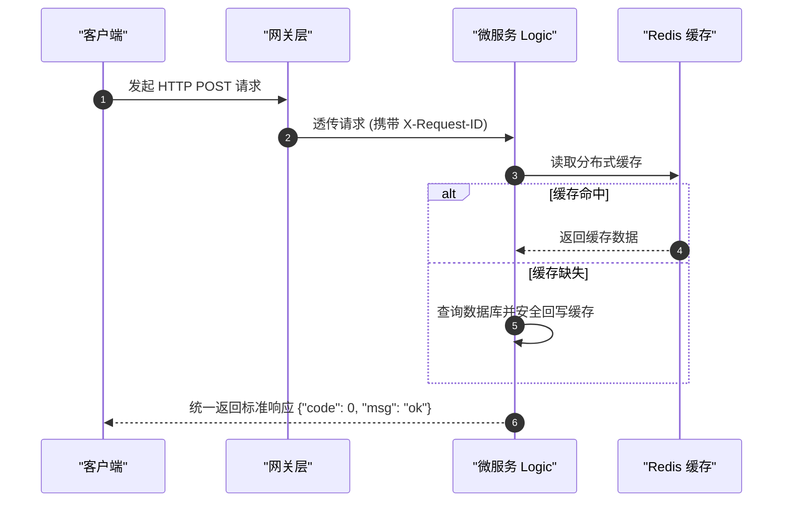

# Mermaid 图表防崩 4 大铁律与标准范式 (Zero-Crash Diagramming)

## 1. 🚨 Mermaid 防崩 4 大铁律（必须 100% 遵守）

### 🚫 铁律 1：严禁菱形/判断节点嵌套花括号 `{...}`
- **崩溃根因**：Mermaid 中 `{` 和 `}` 是菱形判断节点的专用形状语法。若文本内部出现花括号，AST 词法分析器必定抛出语法错误；
- ❌ **严禁写法**：`DECISION{"检查租户: {tenant_id}"}`
- ✅ **标准写法**：`DECISION["检查租户: <tenant_id>"]` 或 `DECISION{"检查租户: tenant_id"}`

### 🚫 铁律 2：连线条件 `|...|` 必须为纯文本
- **崩溃根因**：连线管道符内部包含中英文圆括号 `()`、逗号 `,`、分号 `;`、冒号 `:` 等特殊符号，会导致各大 Markdown 预览器连线中断；
- ❌ **严禁写法**：`-->|超时未响应 (超过 30s)|`
- ✅ **标准写法**：`-->|超时超过 30 秒|`

### 🚫 铁律 3：所有节点 Label 文本强制显式双引号包裹
- **崩溃根因**：节点文本包含空格、冒号、斜杠或 SQL 关键字若无双引号，会被误识别为图元属性；
- ❌ **严禁写法**：`NODE[URL: /api/v1/user]`
- ✅ **标准写法**：`NODE["URL: /api/v1/user"]`

### 🚫 铁律 4：连线必须精确连接到具体节点 ID
- **崩溃根因**：严禁将箭头直接连向 `subgraph` 容器名称，必须精确连接至子图内部的入口节点 ID；
- ❌ **严禁写法**：`A["发起请求"] --> BackendCluster`
- ✅ **标准写法**：`A["发起请求"] --> GatewayNode`

---

## 2. 标杆安全时序图模版

